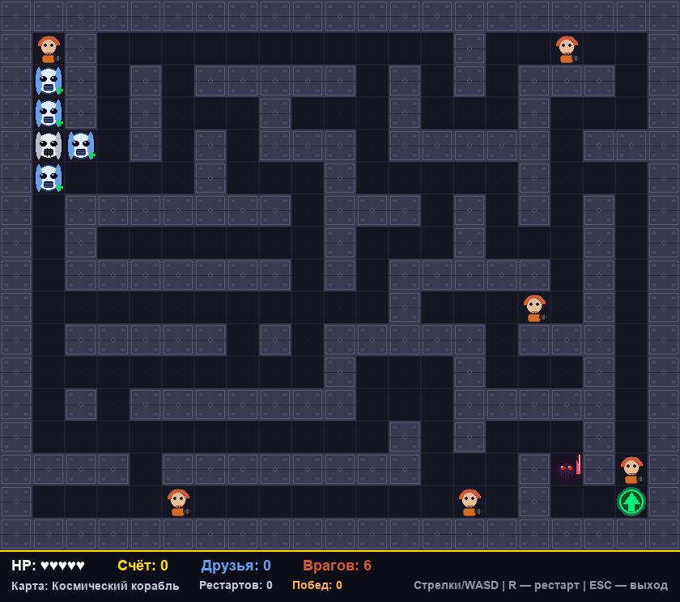

# Star Wars: Stormtrooper Maze

Аркадный лабиринт на **pygame-ce**: ты играешь за штурмовика, собираешь друзей,
убегаешь от Дарта Вейдера и ищешь выход с уровня.



## Об игре

Каждый рестарт генерирует новый лабиринт 21×17 (алгоритм «recursive backtracker» +
12 дополнительных проходов), поэтому двух одинаковых уровней не бывает.

- 🪖 **Штурмовик** — это ты. Запас прочности — **5 HP**.
- 👥 **Друзья** (4 на уровне) — подбери их: **+50 очков** и **+1 HP** (не больше 5).
- 🧑‍🚀 **Повстанцы** — враги. Наступи на него — он уничтожен, **+100 очков**.
  На старте их 6, и с каждой победой становится на одного больше.
- 🖤 **Дарт Вейдер** — охотится по кратчайшему пути (BFS). Столкновение отнимает
  **2 HP** и **50 очков** и отбрасывает штурмовика назад. Каждая победа делает его
  быстрее (примерно на 2%), но не быстрее предела в 4 кадра на шаг.
- 🟢 **Выход** — зелёный портал. Дошёл — победа, счёт сохраняется, а следующий
  уровень станет сложнее: Вейдер быстрее, повстанцев больше.

Вся графика (спрайты, стены, пол) рисуется кодом, а звуки шагов, подбора, бластера,
взмаха меча и дыхания Вейдера синтезируются процедурно. Фоновая музыка и звуки
победы/поражения подхватываются из папок `sounds/` и `sounds_event/`.

### Карты (темы)

Тема меняется каждые 3 рестарта: **Космический корабль → Татуин → Лес Эндора → Дантуин**.

## Управление

| Клавиша | Действие |
| --- | --- |
| `←` `→` `↑` `↓` или `W` `A` `S` `D` | движение |
| `R` | новая игра (рестарт) |
| `ESC` | выход |

## HUD

В нижней панели видно: **HP** (сердечки), **счёт**, число собранных **друзей**,
сколько осталось **врагов**, текущую **карту**, количество **рестартов** и **побед**.

## Запуск

```powershell
python -m venv .venv
Set-ExecutionPolicy -ExecutionPolicy Bypass -Scope Process
.venv\Scripts\Activate.ps1

pip install pygame-ce
python starwars.py
```

## Сборка exe

```powershell
pip install pyinstaller
pyinstaller --noconfirm --onedir --windowed --name "StarWarsMaze" --icon "icon.ico" --add-data "sounds;sounds" --add-data "sounds_event;sounds_event" --hidden-import=pygame --hidden-import=pygame.freetype --collect-all pygame starwars.py
```

## Структура проекта

```
starwars.py        — игровой цикл, логика, отрисовка и HUD
assets_gen.py      — генерация лабиринта, спрайтов и цветовых тем
audio.py           — музыка, звуки событий и процедурные SFX
.tools/            — вспомогательные скрипты:
  make_assets.py     — PNG-спрайты персонажей в assets/
  make_screenshot.py — скриншот игры в .stems/screenshot.png
sounds/            — фоновая музыка (*.mp3)
sounds_event/      — win.mp3, fall.mp3, rebels.mp3
assets/            — готовые PNG-спрайты персонажей
.stems/            — скриншоты для README
```

## Обновить скриншот в README

```powershell
python .tools/make_screenshot.py
```

Скрипт рендерит игру в скрытом режиме (без открытия окна) и перезаписывает
`.stems/screenshot.png`.
